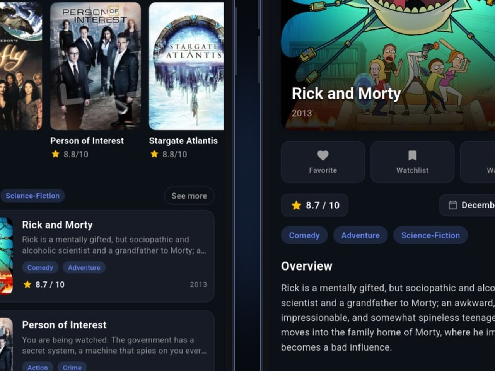

# FilmMix – The Ultimate Flutter Movie & TV Experience

<p align="center">
  
</p>

<p align="center">
  <b>FilmMix</b> is an elegant, open-source movie and television discovery app built with <b>Flutter</b> and <b>GetX</b>. Explore trending titles, filter by genre, manage your personal library with a 3-tier watchlist, and enjoy a seamless experience across <b>Cinematic Dark</b>, <b>Pure AMOLED Black</b>, and <b>Clean Light</b> themes.
</p>

<p align="center">
  
  
  
  
  
</p>

---

## App Preview

<p align="center">
  
</p>

---

## Key Features

- **High-Speed Discovery:** Powered by the TVMaze REST API for fast, unrestricted, and uncensored global access without requiring an API key.
- **Interactive Genre Filtering:** Instantly filter Top Rated and Popular titles with responsive category pills (Sci-Fi, Action, Drama, Comedy, Crime, and more).
- **Multi-Theme Engine:**
  - **Cinematic Dark Mode:** Deep obsidian (`#0C1017`) designed for cinema lovers in low-light environments.
  - **Pure AMOLED Black:** True `#000000` pitch black background for OLED battery savings.
  - **Clean Light Mode:** Crisp, high-contrast modern palette for daytime readability.
  - State persisted locally using **GetStorage**.
- **3-Tier Watchlist & Library:**
  - Mark titles as **Favorite** ❤️, save them to your **Watchlist** 📑, or mark them as **Watched** ✅.
  - **Backup & Restore (JSON):** Export your personal library to standard JSON or restore it on any device.
  - Swipe-to-dismiss deletion with instant undo notifications.
  - Quick-filter chips to view specific library categories.
- **Rich Title Details:**
  - High-resolution poster and backdrop art with smooth gradient overlays.
  - Comprehensive **Cast & Crew** horizontal carousel with character details.
  - **"More Like This"** intelligent recommendations based on genre matching.
  - Direct **Trailer Streaming**, web search, and social sharing.
- **Smart Search & Filter:**
  - Real-time search with debouncing to minimize network overhead.
  - Filter and sort search results by rating (Highest to Lowest, Lowest to Highest, or Default).
- **Settings & Storage Manager:**
  - Toggle themes and AMOLED mode on the fly.
  - Library analytics counter with one-tap option to clear saved bookmarks.
  - Open-source attribution and developer links.
- **Shimmer Skeleton Loading:** Adaptive, theme-aware shimmer animations that prevent bright flashes in dark mode.

---

## Architecture & Tech Stack

```
lib/
├── controllers/          # GetX Controllers (Home, Search, Details, Bookmark, Theme)
├── core/
│   ├── router/          # Route names & GetPage routing bindings
│   ├── service/         # API Service (TVMaze) & Theme Service
│   └── widgets/         # Reusable widgets (MovieCard, ShimmerLoadingBox)
├── model/
│   ├── dto/             # Consolidated, null-safe MovieModel & CastMember DTOs
│   ├── network/         # Dio ApiManager & Endpoint configurations
│   └── storage/         # LocalStorageManager (GetStorage abstraction with JSON backup)
└── view/
    └── pages/           # UI Screens (Home, Details, Search, Bookmark, Settings, About)
```

| Technology | Purpose |
|---|---|
| **Flutter & Dart** | Cross-platform UI toolkit and language |
| **GetX** | State management, dependency injection, and reactive route navigation |
| **Dio** | Robust HTTP networking with timeouts and error handling |
| **GetStorage** | Fast, synchronous local key-value persistence |
| **CachedNetworkImage** | Memory-efficient image caching with fallback error widgets |
| **Shimmer** | Theme-adaptive skeleton loading placeholders |
| **Url Launcher** | External browser search, trailers, and profile links |
| **Share Plus** | Native sharing of movies and JSON watchlist backups |

---

## Getting Started

### Prerequisites
- [Flutter SDK](https://flutter.dev/docs/get-started/install) (version 3.24 or newer recommended)
- Android Studio / VS Code with Flutter extension
- An Android device or emulator

### Installation

1. **Clone the repository:**
   ```bash
   git clone https://github.com/ebadimobina/filmmix.git
   cd filmmix
   ```

2. **Install dependencies:**
   ```bash
   flutter pub get
   ```

3. **Run the app:**
   ```bash
   flutter run
   ```

4. **Run tests:**
   ```bash
   flutter test
   ```

---

## Automated GitHub Releases & Open Source

This repository includes a pre-configured **GitHub Actions CI/CD** workflow (`.github/workflows/release.yml`) that automatically builds and publishes release APKs whenever a git version tag is pushed:

```bash
git tag v1.0.0
git push origin v1.0.0
```

Once pushed, users can download the compiled APK directly from GitHub Releases or install it with automatic updates via **[Obtainium](https://github.com/ImranR98/Obtainium)** or **IzzyOnDroid**.

---

## Author

**Mobina Ebadi**
- GitHub: [@ebadimobina](https://github.com/ebadimobina)
- Buy Me a Coffee: [buymeacoffee.com/mobinaebadi](https://buymeacoffee.com/mobinaebadi)

---

## License

This project is licensed under the MIT License - see the [LICENSE](LICENSE) file for details.
